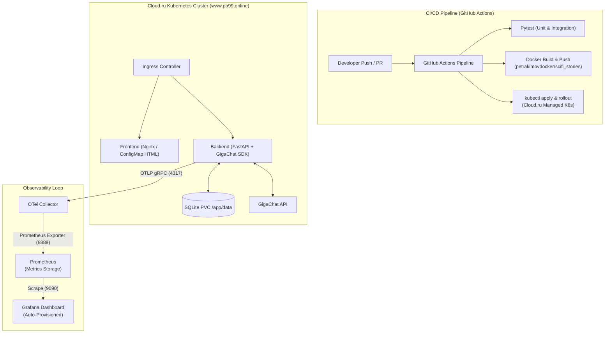
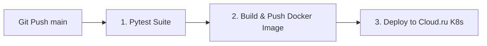

# Sci-Fi Chronicles Generator (`Sci-Fi Story Generator`)

An AI-assisted full-stack application that generates immersive science-fiction stories using Large Language Models via GigaChat API, stores them in persistent SQLite storage, and incorporates end-to-end OpenTelemetry observability with Kubernetes deployment and automated CI/CD delivery.

Built as part of the **AI Dev Tools Zoomcamp 2026** Final Project.

---

## Tech Stack

- **Frontend**: HTML5, Modern JavaScript (Fetch API), CSS3 (Nginx Static Serving)
- **Backend**: Python 3.12, FastAPI, Uvicorn, SQLAlchemy
- **Database**: SQLite (Persistent Volume Claim in Kubernetes)
- **LLM Gateway**: GigaChat API (`GigaChat-2`) via GigaChat Python SDK
- **Package Manager**: `uv`
- **Observability & Telemetry**:
  - **OpenTelemetry**: Metrics and Traces instrumentation (`opentelemetry-sdk`, `opentelemetry-exporter-otlp`)
  - **OpenTelemetry Collector**: In-cluster OTel Collector (`otel/opentelemetry-collector-contrib`)
  - **Prometheus**: Time-series metrics collection & scraping (`http_server_duration_milliseconds_*`, `http_server_active_requests`)
  - **Grafana**: Automated dashboard provisioning for real-time application metrics
- **Containerization & Orchestration**: Docker, Docker Compose, Kubernetes (Deployments, Services, ConfigMaps, Secrets, Ingress, PVC)
- **Cloud Provider (Cloud.ru)**: Managed Kubernetes Cluster, Cloud.ru Managed DNS (`pa99.online`)
- **CI/CD**: GitHub Actions (Pytest Integration & Unit Tests, Docker Hub Build & Push, Cloud.ru Kubeconfig & Auto-Deploy)

---

## Architecture & Telemetry Loop




## Repository Structure

```
.
├── .github/
│   └── workflows/
│       └── deploy.yml           # CI/CD: Pytest, Docker Build/Push, K8s Auto-Deploy
├── backend/                     # FastAPI core application
│   ├── app/
│   │   ├── main.py              # Application entrypoint & OTel Instrumentation
│   │   ├── config.py            # Environment configurations
│   │   ├── database.py          # SQLAlchemy SQLite connection
│   │   ├── models.py            # DB schema definitions
│   │   └── services.py          # GigaChat API integration with custom OTel spans
│   └── tests/                   # Pytest test suite (Unit & Integration)
├── frontend/                    # Static Web Interface (index.html)
├── k8s/                         # Kubernetes Deployment Manifests
│   ├── backend.yaml             # SQLite PVC, OTel Collector, Backend Deployment & Service
│   ├── frontend.yaml            # Nginx Frontend Deployment, ConfigMap & Service
│   ├── ingress.yaml             # Ingress rules for www.pa99.online
│   ├── monitoring.yaml          # Prometheus & Provisioned Grafana Dashboard
│   └── configmap-secret.yaml.template # Template for GigaChat credentials
├── otel-collector-config.yaml   # OpenTelemetry Collector configuration
├── prometheus.yml               # Prometheus scrape configuration
├── docker-compose.yml           # Local dev environment with full telemetry stack
├── Dockerfile                   # Backend Docker container build definition
└── pyproject.toml               # Python dependencies and uv configuration
```


## Environment Setup & Local Development

### Prerequisites

Ensure you have the following installed:
- Python >= 3.12
- `uv` (Fast Python package manager)
- Docker & Docker Compose
- `kubectl` (configured for Kubernetes access)

### 1. Environment Configuration

Copy the configuration template and set your GigaChat API credentials:

```bash
cp k8s/configmap-secret.yaml.template k8s/configmap-secret.yaml
```

#### Set the required environment variables:

```
export GIGACHAT_API_KEY="YOUR_GIGACHAT_AUTH_KEY"
export GIGACHAT_MODEL="GigaChat-2"
export DATABASE_URL="sqlite:///./scifi_stories.db"
```

### 2. Running Locally with Docker ComposeStart the full stack including Backend, Frontend, OTel Collector, Prometheus, and Grafana:

```
docker compose up --build -d
```

### 3. Infrastructure Provisioning (Terraform)

Before deploying the application via CI/CD, set up the cloud infrastructure using Terraform:

```bash
cd infra

# Initialize Terraform working directory and download providers
terraform init

# Review execution plan
terraform plan

# Apply infrastructure changes
terraform apply
```

Terraform provisions:

- Managed Kubernetes cluster and node group.
- Ingress-Nginx controller.
- DNS zone and A-record.

#### Local Endpoints
- **Frontend UI**: `http://www.pa99.online` 
- **Backend API Docs**: `http://www.pa99.online/docs`

---

## CI/CD Pipeline & Continuous Deployment (GitHub Actions)

Deployment to the **Cloud.ru Kubernetes cluster** is fully automated using GitHub Actions (`.github/workflows/deploy.yml`). No manual `kubectl apply` commands are required during standard releases.

### Pipeline Workflow Trigger

Pushing code to the `main` branch automatically triggers the pipeline:



### 1. Test Stage
- Sets up Python 3.12 environment with `uv`.
- Installs dependencies and runs unit & integration tests via `pytest`.

### 2. Build & Push Stage
- Authenticates with Docker Hub.
- Builds multi-platform Docker container (`petrakimovdocker/scifi_stories:latest`).
- Pushes updated image to Docker Hub repository.

### 3. Deploy Stage
- Authenticates to Cloud.ru Kubernetes cluster using `cloudlogin` and `KUBECONFIG_BASE64` stored in Repository Secrets.
- Substitutes environment secrets into `k8s/configmap-secret.yaml.template` using `envsubst`.
- Applies all K8s manifests (`backend.yaml`, `frontend.yaml`, `ingress.yaml`, `monitoring.yaml`).
- Performs a zero-downtime rolling update (`kubectl rollout restart deployment`).

### Required GitHub Repository Secrets

Configure the following secrets under **Settings > Secrets and variables > Actions**:

| Secret Name | Description |
| :--- | :--- |
| `DOCKERHUB_USERNAME` | Docker Hub account username |
| `DOCKERHUB_TOKEN` | Docker Hub Access Token |
| `GIGACHAT_API_KEY` | GigaChat API Key for LLM story generation |
| `CLOUD_RU_KUBECONFIG` | Base64-encoded `kubeconfig` for Cloud.ru cluster access |

---

## Production Environments & Access Points

Once GitHub Actions successfully completes execution:

- **Public Web Application**: [http://www.pa99.online](http://www.pa99.online)
- **Public REST API**: [http://www.pa99.online/api/v1/stories](http://www.pa99.online/api/v1/stories)
- **Interactive Swagger Docs**: [http://www.pa99.online/docs](http://www.pa99.online/docs)

---

## Observability & Monitoring

The cluster runs OpenTelemetry, Prometheus, and Grafana provisioned automatically alongside the core stack:

- **OpenTelemetry Instrumentation**: Tracks FastAPI incoming requests, latency distribution, payload sizes, and custom GigaChat generation spans (`gigachat_generation`).
- **Prometheus**: Automatically scrapes OTel Collector metrics at `otel-collector:8889`.
- **Grafana Dashboard**: Auto-provisioned pre-configured dashboard (**Sci-Fi Story Generator - Observability**) showing live RPS, p95 latency, active requests, and memory/CPU trends.

To inspect Grafana in the cluster locally via port forwarding:
```bash
kubectl port-forward svc/grafana-svc 3000:3000

Open `http://www.pa99.online:3000` to view active dashboards (via port forwarding or configured Ingress).

---

## API Endpoints

| Method | Endpoint | Description |
| :--- | :--- | :--- |
| `GET` | `/api/v1/stories` | Retrieve all archived sci-fi stories |
| `POST` | `/api/v1/stories` | Generate a new sci-fi story via GigaChat and store in database |
| `GET` | `/docs` | Interactive Swagger documentation |

---

## Quick API Test via `curl`

Generate a new story:
```bash
curl -X POST "[http://www.pa99.online/api/v1/stories](http://www.pa99.online/api/v1/stories)" \
  -H "Content-Type: application/json" \
  -d '{
    "title": "Fatal Mistake",
    "heroes": "Miss Wells - scientist, Mr. Hide - scammer",
    "when_happens": "Year 2222",
    "where_happens": "Planet Jelly Fish",
    "summary": "Miss Wells creates a teleportation device, but due to a fatal mistake, she is trapped in the past."
  }' | jq
```
### Fetch all stories:

```
curl -i [http://www.pa99.online/api/v1/stories](http://www.pa99.online/api/v1/stories)
```

